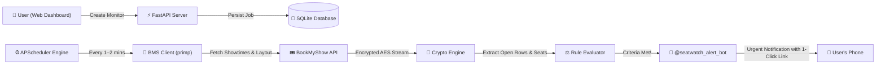
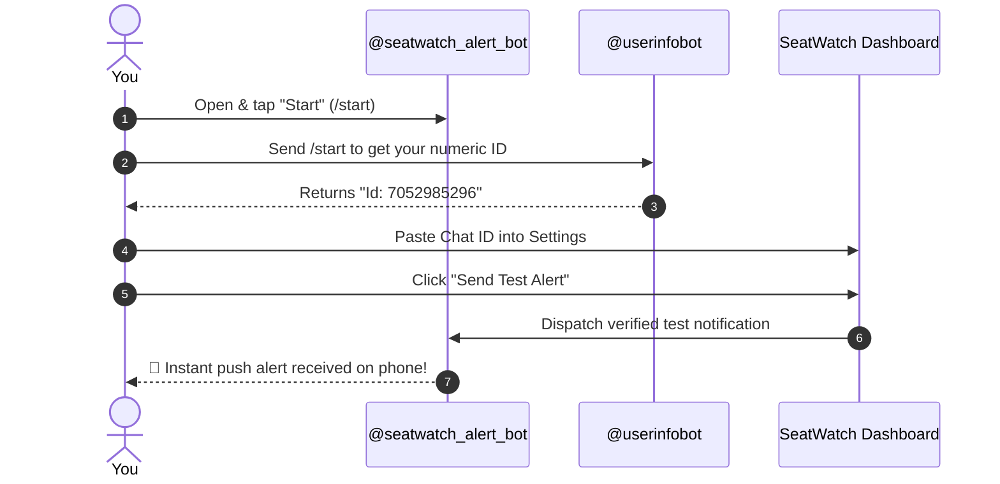

<div align="center">

# 🎬 BookMyShow Ticket Notifier & Seat Tracker (SeatWatch)
### Automated Real-Time BMS Seat Polling, AES-256 Layout Decryption & Instant Telegram Alerts

[](https://python.org)
[](https://fastapi.tiangolo.com)
[](https://t.me/seatwatch_alert_bot)
[](https://www.docker.com/)
[](https://opensource.org/licenses/MIT)
[](https://github.com/Vem-Manish/Movie_SeatWatch)

<p align="center">
  <b>Never miss prime movie seats again.</b><br>
  SeatWatch autonomously monitors BookMyShow 24/7 for unopened future dates, decrypts live seat maps in memory, checks multi-row and consecutive seat rules, and pings your private Telegram with direct 1-click booking links the exact second tickets drop.
</p>

[✨ Key Features](#-key-features) • [⚡ 30-Second Quickstart](#-30-second-quickstart) • [🤖 Zero-Config Telegram Setup](#-zero-config-telegram-setup) • [🎯 Advanced Monitoring Rules](#-advanced-monitoring-rules) • [🐳 Docker & Cloud Deployment](#-docker--cloud-deployment) • [📡 REST API](#-rest-api-reference)

---

</div>

## 📌 Why SeatWatch?

For blockbuster releases (*Pushpa 2, Ramayana, Marvel, Avatar, Kalki, Nolan IMAX releases*), ticket sales open unannounced. The best seats (center rows, recliners, IMAX sweet spots) vanish **within 90 seconds**.

- ❌ **Manually refreshing BookMyShow all day is exhausting, inconsistent, and slow.**
- ❌ **Standard "notify me" apps only alert when an entire movie goes live—not when specific rows or preferred time slots open.**
- ❌ **Third-party scraper tools frequently trigger Cloudflare blocks or crash due to heavy headless browser overhead (Puppeteer/Selenium).**

### 💡 The SeatWatch Solution
**SeatWatch** runs lightweight background polling directly against official BookMyShow endpoints using native HTTP impersonation (`primp`). It decrypts BookMyShow's proprietary AES-256 seat layouts in sub-100ms in-memory, checks whether your exact row/seat conditions are satisfied, and immediately triggers an **urgent Telegram alert** to your phone with a direct 1-click booking link.

---

## 🌟 Key Features

### 🏛️ 1. Cinema-First & Exact Format Targeting
- Select your **City** $\rightarrow$ **Specific Theatre** $\rightarrow$ **Date** $\rightarrow$ **Movie** $\rightarrow$ **Exact Experience**.
- Distinguishes between *Telugu • Dolby Cinema 3D*, *Hindi • IMAX 3D*, *Telugu • 2D*, *4DX*, and standard screens.

### 🔮 2. Advance Unopened Dates Prediction
- Target dates where BookMyShow **has not opened booking yet** (e.g. next Friday/Saturday/Sunday).
- Analyzes existing cinema patterns to predict upcoming screen formats and schedules. SeatWatch silently polls 24/7 until the showtime drops.

### 🎯 3. Multi-Row & Flexible Seat Range Tracking
- **Row Range + Seat Range**: Target broad clusters (e.g., *Rows B to I, Seats 12 to 25*).
- **Consecutive Seat Assurance**: Guarantees your group sits together (e.g., *Requires 4 consecutive adjacent seats*).
- **Multi-Selection Fallback**: Configure primary and backup options in one monitor (e.g., *Selection 1: Rows B–H Center, 4 seats* **OR** *Selection 2: Row J Balcony, 2 seats*).

### ⭐ 4. Auditorium & Screen Tag Filtering
- Filter specific premium auditoriums within a theatre (e.g. monitor only `PXL` or `Audi 6`, while ignoring standard screens showing the same movie).

### ⚡ 5. Sub-100ms In-Memory AES-256 Decryption
- Reverses BookMyShow's proprietary encrypted layout streams (`doTrans.aspx`) without requiring heavy, detectable headless browsers.

### 🤖 6. Built-In Zero-Config Telegram Bot
- Pre-configured with the official **[@seatwatch_alert_bot](https://t.me/seatwatch_alert_bot)**.
- **Zero BotFather setup required**: Anyone who clones the repo simply enters their personal **Chat ID** and receives alerts instantly.
- Multi-user ready: Host a single instance for yourself, your friends, or your community.

### 🔁 7. Continuous Watch & Smart Throttling
- Monitors **do not stop** after finding seats. They continue watching continuously until you manually pause or delete them.
- **Smart Alert Deduplication**: Prevents spam by throttling repetitive alerts for identical seats to a 15-minute reminder window, while firing instantly if new seats open.

### 🔗 8. Native BookMyShow Deep-Linking
- *"Look at Layout on BMS"* button opens the official interactive hall view in a new tab so you can visually verify row lettering before locking in alerts.

---

## 🏗️ System Architecture



---

## ⚡ 30-Second Quickstart

### Prerequisites
- Python 3.10 or higher
- Git

### 1. Clone & Set Up Virtual Environment

```bash
# Clone the repository
git clone https://github.com/Vem-Manish/Movie_SeatWatch.git
cd Movie_SeatWatch

# Create virtual environment
python -m venv venv

# Activate virtual environment
# Windows (PowerShell):
.\venv\Scripts\Activate.ps1
# Windows (CMD):
.\venv\Scripts\activate.bat
# Linux / macOS:
source venv/bin/activate

# Install dependencies
pip install -r requirements.txt
```

### 2. Launch the Application

```bash
python run.py
```

Open your browser and navigate to **[http://localhost:8000](http://localhost:8000)**.

---

## 🤖 Zero-Config Telegram Setup

You **do not** need to create your own bot via BotFather. SeatWatch comes connected to the official **[@seatwatch_alert_bot](https://t.me/seatwatch_alert_bot)**!



### Quick 3-Step Setup:
1. Open [**@seatwatch_alert_bot**](https://t.me/seatwatch_alert_bot) on Telegram and tap **Start** (or send `/start`). *(This gives Telegram permission to message you).*
2. Message [**@userinfobot**](https://t.me/userinfobot) (or [@raw_data_bot](https://t.me/raw_data_bot)) to get your numeric **`Id`** (e.g. `7052985296`).
3. In the SeatWatch dashboard, switch to the **Telegram Bot** tab, paste your Chat ID, and click **Save Settings**!
4. Click **Send Test Alert** to verify connectivity.

---

### 🚨 Pro-Tip: Turn Your Telegram Alert into an Urgent Siren!

Hot movie tickets disappear in under 2 minutes. Make sure you hear the alert even if your phone is in your pocket or on silent:

1. Click **Send Test Alert** from the dashboard.
2. In Telegram, open the conversation with [**@seatwatch_alert_bot**](https://t.me/seatwatch_alert_bot).
3. Tap the bot's name/profile at the top $\rightarrow$ **Notifications** $\rightarrow$ **Customize**.
4. Enable **Custom Sound** and pick a **loud, distinctive ringtone**.
5. Set priority to **Urgent / High** (or allow "Bypass Do Not Disturb" on Android/iOS).
6. Now you will never miss a ticket release, even while sleeping!

> 💡 **Self-Hosters & Custom Bots**: If you prefer to use your own private bot, simply create one with [@BotFather](https://t.me/BotFather) and enter your custom Bot Token in the collapsible **Advanced Settings** section or set `TELEGRAM_BOT_TOKEN="your_token"` in your `.env`.

---

## 🎯 Advanced Monitoring Rules

SeatWatch supports 4 specialized rule types tailored for movie enthusiasts:

| Rule Type | When to Use | How It Works |
| :--- | :--- | :--- |
| **`MULTI_SELECTION`** | Prime seats across multiple rows | Specify row range (e.g. `B-I`), seat range (e.g. `12-25`), minimum seat count, and consecutive seating. Supports multiple fallback selection blocks. |
| **`ROW_SEAT_COUNT`** | Watching one specific favorite row | Alerts when at least $N$ seats open in row `E` or `F`. Optional consecutive toggle. |
| **`SPECIFIC_SEATS`** | VIP / Recliner exact seat targeting | Alerts when exact specific seats (e.g. `J14, J15`) become vacant. |
| **`BOOKING_OPEN`** | Unreleased shows & advance dates | Instant ping the exact second BookMyShow opens bookings for the target show, regardless of seat position. |

---

## 🐳 Docker & Cloud Deployment

### Run with Docker

```bash
# Build the Docker image
docker build -t seatwatch .

# Run the container
docker run -d \
  -p 8000:8000 \
  -v $(pwd)/data:/app/data \
  --name seatwatch \
  --restart unless-stopped \
  seatwatch
```

### Run with Docker Compose

A pre-configured `docker-compose.yml` is included in the repository:

```bash
docker compose up -d
```

View logs:
```bash
docker compose logs -f
```

---

### Deploy to Cloud Platforms

SeatWatch is container-ready and can be deployed with 1 click to any cloud provider:

#### 1. Deploy on Railway / Render / Fly.io
- Connect your GitHub fork of `Movie_SeatWatch`.
- Set Environment Variables (optional):
  - `PORT=8000`
  - `TELEGRAM_BOT_TOKEN="your_custom_token_here"` (optional override)
  - `SEATWATCH_DB_PATH=/app/data/seatwatch.db`
- Build command: automatic from Dockerfile!

#### 2. Deploy on Linux VPS (Ubuntu / Debian systemd)
Create a systemd unit file at `/etc/systemd/system/seatwatch.service`:

```ini
[Unit]
Description=SeatWatch BookMyShow Monitor
After=network.target

[Service]
Type=simple
User=ubuntu
WorkingDirectory=/home/ubuntu/Movie_SeatWatch
ExecStart=/home/ubuntu/Movie_SeatWatch/venv/bin/python run.py
Restart=always
RestartSec=5

[Install]
WantedBy=multi-user.target
```

Enable and start:
```bash
sudo systemctl daemon-reload
sudo systemctl enable --now seatwatch
```

---

## 📡 REST API Reference

SeatWatch exposes clean RESTful APIs with automatic OpenAPI docs at `http://localhost:8000/docs`:

| Method | Endpoint | Description |
| :---: | :--- | :--- |
| `GET` | `/api/regions` | Discovers all BookMyShow cities, codes, and slugs. |
| `GET` | `/api/movies?city_slug=hyderabad` | Lists currently trending movies in the city. |
| `GET` | `/api/cinemas?city_slug=hyderabad` | Discovers all cinema halls and venues in the city. |
| `GET` | `/api/cinema_showtimes?city_code=HYD&venue_code=ALLU&target_date=20261108` | Fetches live shows, screen tags, formats, and predicted future schedules. |
| `GET` | `/api/monitors` | Lists all active and past monitoring jobs. |
| `POST` | `/api/monitors` | Creates and activates a new seat monitoring job. |
| `POST` | `/api/monitors/{id}/check_now` | Triggers an immediate ad-hoc check for a monitor. |
| `POST` | `/api/monitors/{id}/pause` | Pauses background execution for a monitor. |
| `POST` | `/api/monitors/{id}/resume` | Resumes background polling. |
| `DELETE`| `/api/monitors/{id}` | Deletes a monitor and clears its check logs. |
| `POST` | `/api/test_telegram` | Dispatches an instant test notification to a Telegram Chat ID. |
| `GET` | `/api/settings` | Retrieves active system configurations. |
| `POST` | `/api/settings` | Updates Telegram Chat ID or polling parameters. |

---

## 🧪 Running Tests

The test suite validates end-to-end BMS discovery, AES decryption, rule evaluations, and schedule fallbacks:

```bash
python test_e2e.py
```

Expected output:
```text
Ran 12 tests in 6.491s
OK
[OK] Regions Discovery verified.
[OK] Movies Discovery verified (10 movies found).
[OK] BMS AES-256 Layout Decryption verified (130 seats parsed, 10 open, walkways & aisles preserved).
[OK] Rule Evaluator conditions verified.
[OK] Monitor creation, live check execution, and DB logging verified.
...
```

---

## 🔒 Security & Fair-Use Notice

- **Independent Project**: SeatWatch is an independent personal research utility built for fair-use ticket notifications. It is not affiliated with, authorized by, or endorsed by BookMyShow (Bigtree Entertainment Pvt. Ltd.).
- **Privacy First**: SeatWatch runs on your own hardware or private cloud. No telemetry, passwords, or personal booking data are collected or transmitted to external servers.
- **Respectful Polling**: The default polling interval is set to 2–3 minutes to ensure gentle traffic that stays well below API thresholds.

---

## 🤝 Contributing

Contributions, issues, and feature requests are welcome!
Feel free to check the [issues page](https://github.com/Vem-Manish/Movie_SeatWatch/issues).

1. Fork the Project
2. Create your Feature Branch (`git checkout -b feature/AmazingFeature`)
3. Commit your Changes (`git commit -m 'feat: Add some AmazingFeature'`)
4. Push to the Branch (`git push origin feature/AmazingFeature`)
5. Open a Pull Request

---

## 📄 License

Distributed under the **MIT License**. See [`LICENSE`](LICENSE) for more information.

<div align="center">
  <sub>Built with ❤️ for cinema lovers and prime-seat enthusiasts.</sub>
</div>
