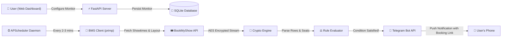

<div align="center">

# 🎬 SeatWatch
### Automated BookMyShow Seat Monitoring & Instant Telegram Alert System

[](https://python.org)
[](https://fastapi.tiangolo.com)
[](https://core.telegram.org/bots)
[](https://www.docker.com/)
[](https://opensource.org/licenses/MIT)

*Never miss prime seats again. SeatWatch automatically polls BookMyShow every 2–3 minutes for unopened shows, specific rows, and adjacent seat blocks — pinging your private Telegram the exact second tickets become available.*

[Features](#-key-features) • [Deployment Guide](#-cloud-deployment-guide) • [Multi-User Telegram](#-multi-user-telegram-bot-setup) • [Quickstart](#-quickstart-local) • [Architecture](#-architecture)

---

</div>

## 📌 The Problem
Blockbuster movie tickets (IMAX 3D, Dolby Cinema, Recliners, opening weekends) sell out the best seats in minutes. Manually refreshing BookMyShow throughout the day for unopened dates (e.g. next Saturday/Sunday) is tedious, unreliable, and exhausting.

## 💡 The Solution
**SeatWatch** runs continuously in the background. It connects directly to BookMyShow's APIs, decrypts live seat maps on the fly, evaluates your custom row and seat conditions, and immediately pushes a private Telegram notification with a **direct 1-click booking link** straight to your phone.

---

## 🌟 Key Features

* 🏛️ **Cinema-First & Format-Rich Discovery**
  * Select your City $\rightarrow$ Specific Cinema $\rightarrow$ Target Date $\rightarrow$ Movie $\rightarrow$ Exact Format experience (*Telugu • Dolby Cinema 3D*, *Hindi • IMAX 3D*, *Telugu • 2D*, etc.).
* 🔮 **Advance Unopened Dates Prediction**
  * Target future dates where BookMyShow has **not opened ticket sales yet** (e.g. next Saturday/Sunday). SeatWatch analyzes the cinema's active schedule to predict the formats and watches BookMyShow 24/7 until the shows go live.
* 🎯 **Smart Multi-Row & Range Monitoring**
  * Target broad row ranges and seat intervals: e.g., **Rows B to I, Seats 12 to 25, 4 consecutive seats**.
  * Add multiple fallback selections: e.g., *Selection 1: Rows B–I (Center)* **OR** *Selection 2: Row J (Director choice, 2 seats)*.
* ⭐ **Auditorium & Screen Tag Filtering**
  * Filter specific premium auditoriums: e.g., monitor only `PXL` (`PXL Audi 6`) or `DOLBY CINEMA` screens and ignore standard screens in the same format.
* ⚡ **Sub-100ms In-Memory AES Decryption**
  * High-performance decryption of BookMyShow's encrypted layout streams (`doTrans.aspx`) without requiring heavy, detectable headless browsers (Puppeteer/Selenium).
* 🤖 **Multi-User Telegram Notifications**
  * Host a single SeatWatch server for yourself, your friends, or your community. Anyone can create monitors and input their personal Telegram Chat ID to receive private alerts.
* 🔗 **Native BookMyShow Deep-Linking**
  * One-click *"Look at Layout on BMS"* button opens the official BookMyShow hall view in a new tab so you can view physical seat layouts before locking in rules.

---

## 🏗️ Architecture



---

## 🚀 Quickstart (Local)

### 1. Prerequisites
* Python 3.10 or higher
* Git

### 2. Clone and Install
```bash
# Clone the repository
git clone https://github.com/Vem-Manish/Movie_SeatWatch.git
cd Movie_SeatWatch

# Create and activate virtual environment
python -m venv venv
# On Windows:
venv\Scripts\activate
# On Linux / macOS:
source venv/bin/activate

# Install dependencies
pip install -r requirements.txt
```

### 3. Launch SeatWatch
```bash
python run.py
```
Open **[http://localhost:8000](http://localhost:8000)** in your browser!

---

## 🤖 Multi-User Telegram Bot Setup

You only need to create **ONE master Telegram Bot**. Multiple users can then enter their own Chat IDs to receive private alerts.

### 1. Create Your Telegram Bot
1. Open Telegram and message **[@BotFather](https://t.me/BotFather)**.
2. Send `/newbot`, choose a name (e.g., `MySeatWatchBot`) and a username (e.g., `my_seatwatch_bot`).
3. Copy the **HTTP API Bot Token** (looks like `7123456789:AAH...`).

### 2. Configure the Bot Token
You can provide the token in two ways:
* **Option A (Web UI)**: Navigate to the **Telegram Bot** tab in the web dashboard, paste your token, and click **Save Settings**.
* **Option B (Environment Variable)**: Set `TELEGRAM_BOT_TOKEN="your_token_here"` in your cloud dashboard or `.env`.

### 3. How Users Receive Alerts
1. Users open Telegram and send `/start` to your bot (e.g. `@my_seatwatch_bot`).
2. Users find their personal numeric Chat ID by sending `/start` to **[@userinfobot](https://t.me/userinfobot)**.
3. When creating a monitor in SeatWatch, users enter their Chat ID in the **"Notify Telegram Chat ID"** field.
4. When tickets matching their row/seat conditions open, your bot messages them privately with the direct booking link!

---

## ☁️ Cloud Deployment Guide

> [!IMPORTANT]
> ### ⚠️ Can I deploy this to Vercel or Netlify?
> **No.** Vercel and Netlify are **serverless platforms**. Serverless functions freeze and terminate when there are no active HTTP requests. They **cannot run a 24/7 background scheduler** (`APScheduler`) to poll BookMyShow every 2 minutes. Furthermore, serverless instances wipe SQLite databases on restarts.
>
> **To run SeatWatch 24/7, deploy to a container or persistent cloud host (Render, Railway, Fly.io, VPS, or Docker).**

---

### Option 1: Render.com (Recommended Free/Easy)
Render provides free/low-cost persistent web services connected directly to your GitHub repository.

1. Fork or push this repository to your GitHub account.
2. Go to **[Render.com](https://render.com)** and sign in.
3. Click **New +** $\rightarrow$ **Web Service**.
4. Connect your GitHub repository.
5. Configure the service:
   * **Name**: `seatwatch`
   * **Language**: `Python 3`
   * **Build Command**: `pip install -r requirements.txt`
   * **Start Command**: `python run.py`
6. Add Environment Variables (under **Advanced**):
   * `TELEGRAM_BOT_TOKEN`: Your bot token from `@BotFather`
   * `PORT`: `8000`
7. Click **Create Web Service**. Your app is now live and monitoring 24/7!

---

### Option 2: Railway.app
1. Go to **[Railway.app](https://railway.app)**.
2. Click **New Project** $\rightarrow$ **Deploy from GitHub repo**.
3. Select your `seatwatch` repo.
4. In **Variables**, add:
   * `TELEGRAM_BOT_TOKEN`: `your_bot_token`
   * `PORT`: `8000`
5. Railway automatically detects the `Dockerfile` and deploys your persistent container.

---

### Option 3: Docker & Docker Compose

#### Run with Docker:
```bash
# Build the Docker image
docker build -t seatwatch .

# Run container with Telegram Token
docker run -d \
  -p 8000:8000 \
  -e TELEGRAM_BOT_TOKEN="your_bot_token" \
  -v seatwatch_data:/app \
  --name seatwatch \
  seatwatch
```

#### Run with Docker Compose (`docker-compose.yml`):
```yaml
version: '3.8'

services:
  seatwatch:
    build: .
    container_name: seatwatch
    restart: unless-stopped
    ports:
      - "8000:8000"
    environment:
      - TELEGRAM_BOT_TOKEN=your_bot_token_here
      - TELEGRAM_CHAT_ID=your_default_chat_id_here
    volumes:
      - ./data:/app
```
Run `docker compose up -d`.

---

### Option 4: Linux VPS (Ubuntu / Debian / DigitalOcean)

```bash
# 1. Update and install python & git
sudo apt update && sudo apt install -y python3-pip python3-venv git

# 2. Clone repo and create venv
git clone https://github.com/Vem-Manish/Movie_SeatWatch.git /opt/seatwatch
cd /opt/seatwatch
python3 -m venv venv
source venv/bin/activate
pip install -r requirements.txt

# 3. Create a systemd service to keep SeatWatch running 24/7
sudo nano /etc/systemd/system/seatwatch.service
```

Paste the following service definition:
```ini
[Unit]
Description=SeatWatch BookMyShow Notifier
After=network.target

[Service]
User=root
WorkingDirectory=/opt/seatwatch
ExecStart=/opt/seatwatch/venv/bin/python /opt/seatwatch/run.py
Restart=always
RestartSec=5
Environment="TELEGRAM_BOT_TOKEN=your_token_here"

[Install]
WantedBy=multi-user.target
```

```bash
# 4. Enable and start the service
sudo systemctl daemon-reload
sudo systemctl enable seatwatch
sudo systemctl start seatwatch
```

---

## 📡 API Reference

SeatWatch provides RESTful JSON APIs for integration or automation:

| Endpoint | Method | Description |
| :--- | :---: | :--- |
| `/api/regions` | `GET` | Discovers all supported cities and codes (e.g. `HYD`, `MUMBAI`, `NCR`). |
| `/api/cinemas?city_slug=hyderabad` | `GET` | Fetches all cinemas in a city. |
| `/api/cinema_showtimes` | `GET` | Fetches live shows, screens, formats, and predicted future schedules. |
| `/api/monitors` | `GET` | Lists all active and past monitoring jobs. |
| `/api/monitors` | `POST` | Creates and starts a new seat monitoring job. |
| `/api/monitors/{id}/check_now` | `POST` | Triggers an immediate check for a monitor. |
| `/api/monitors/{id}/pause` | `POST` | Pauses an active monitor. |
| `/api/monitors/{id}/resume` | `POST` | Resumes a paused monitor. |
| `/api/monitors/{id}` | `DELETE`| Deletes a monitor and its check logs. |

---

## 🔒 Security & Privacy
* SeatWatch communicates directly with official BookMyShow and Telegram APIs.
* No credentials or tracking data are shared with third parties.
* Reverse-engineered layout decryption runs locally in memory; no third-party proxy relays are utilized.

---

## 📄 License
This project is licensed under the [MIT License](LICENSE).

*Disclaimer: SeatWatch is an independent personal project intended for fair-use ticket availability notifications. It is not affiliated with or endorsed by BookMyShow (Bigtree Entertainment Pvt. Ltd.).*
